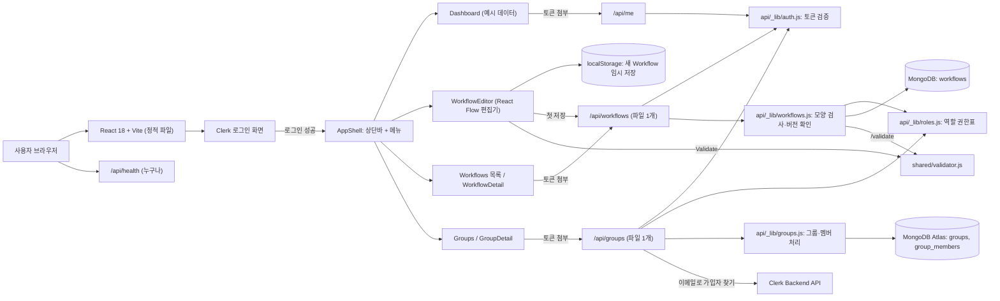

# ARCHITECTURE

목표 구조는 [FLOWBUILDER_DESIGN.md](FLOWBUILDER_DESIGN.md) 2장을 따릅니다.
이 문서는 **지금 실제로 구현된 것**만 적습니다. 구현이 바뀌면 이 문서도 같이 고칩니다.

## 현재 구현 (v0.7.0, 7단계)

## 구성요소

| 구성요소 | 파일 | 상태 |
| --- | --- | --- |
| 화면 틀 | `src/layout/AppShell.jsx` | 구현 |
| 메뉴 목록 | `src/menu.js` | 구현 |
| Dashboard | `src/pages/Dashboard.jsx` | 화면만 (예시 데이터) |
| 편집기 본체 | `src/editor/FlowEditor.jsx` | 구현 (보기 전용, 저장·Ctrl+S, 저장 안 된 변경 표시) |
| 새 Workflow (/editor) | `src/pages/WorkflowEditor.jsx` | 구현 (임시 저장 → Save로 그룹·이름 골라 서버 저장) |
| 저장된 Workflow (/workflows/:id) | `src/pages/WorkflowDetail.jsx` | 구현 (저장, 충돌 안내, 이름 바꾸기, 삭제) |
| Workflow 목록 (/workflows) | `src/pages/Workflows.jsx` | 구현 (그룹 거르기, 새로 만들기) |
| 저장 창 | `src/components/SaveWorkflowDialog.jsx` | 구현 (편집 권한 있는 그룹만) |
| 저장용 모양 변환·비교 | `src/editor/graph.js` | 구현 |
| Workflow API | `api/workflows.js`, `api/_lib/workflows.js` | 구현 |
| API 공통 처리 | `api/_lib/http.js`, `api/_lib/errors.js` | 구현 (groups도 이것을 씀) |
| 노드 목록(종류·출구) | `src/editor/nodeCatalog.js` | 구현 (설계 4.1의 10종) |
| 노드 모양 | `src/editor/WorkflowNode.jsx`, `src/editor/editor.css` | 구현 |
| Node Palette | `src/editor/NodePalette.jsx` | 구현 (검색, 누르기·끌어 놓기) |
| 상단 Toolbar | `src/editor/EditorToolbar.jsx` | 구현 (Save·Validate·Run·Publish는 비활성) |
| 실행 취소·다시 실행 | `src/editor/useHistory.js` | 구현 (최근 50번) |
| 임시 저장 | `src/editor/draftStorage.js` | 구현 (6단계에서 서버 저장으로 교체) |
| Properties 패널 | `src/editor/PropertiesPanel.jsx` | 구현 (넓은 화면은 오른쪽, 그 외는 아래에서 올라오는 창) |
| 노드별 설정 항목·검사·요약 | `shared/nodeFields.js` | 구현 (설계 4.3, 화면·서버 공용) |
| 노드 종류·출구 | `shared/nodeKinds.js` (아이콘은 `src/editor/nodeCatalog.js`) | 구현 (화면·서버 공용) |
| Workflow 검증 | `shared/validator.js` | 구현 (설계 7.3, 화면·서버 공용) |
| 검증 결과 패널·노드 표시 | `src/editor/ValidationPanel.jsx`, `src/editor/validationContext.js` | 구현 |
| 하단 실행 결과 패널 | - | 미구현 (8·10단계) |
| 상태 확인 API | `api/health.js` | 구현 |
| 로그인 화면 | `src/pages/SignInPage.jsx` | 구현 (실제 키 검증 전) |
| 로그인 여부에 따른 화면 전환 | `src/App.jsx`, `src/main.jsx` | 구현 |
| 서버 토큰 검증 | `api/_lib/auth.js` | 구현 |
| 로그인 확인 API | `api/me.js` | 구현 |
| API 호출 공통 함수 | `src/lib/api.js` | 구현 |
| 그룹 목록·만들기 화면 | `src/pages/Groups.jsx` | 구현 |
| 그룹 상세(멤버·역할) 화면 | `src/pages/GroupDetail.jsx` | 구현 |
| 그룹 API (주소 나누기) | `api/groups.js` | 구현 |
| 그룹·멤버 처리 | `api/_lib/groups.js` | 구현 |
| 역할 권한표 | `api/_lib/roles.js` (화면 표시용 이름은 `src/lib/roles.js`) | 구현 |
| Clerk 사용자 조회 | `api/_lib/clerkUsers.js` | 구현 |
| DB 연결 | `api/_lib/db.js` | 구현 (MongoDB Atlas) |
| 실행 엔진 / Runner Adapter | - | 미구현 (8~9단계) |

## 정한 것과 이유

| 결정 | 이유 |
| --- | --- |
| React 18로 고정 | 설계 문서의 확정 기술 스택 |
| 편집기 화면만 따로 불러오기(lazy) | React Flow가 무거워서 첫 화면을 가볍게 하려고 |
| 노드 `type`은 분류, 종류는 `data.kind` | 설계 6.1 예시(`type: "trigger"`)를 지키면서 10종을 구분하려고 |
| 연결선 모양(꺾은 선·화살표)은 화면 설정으로만 | 저장 데이터를 설계 6.1 모양 그대로 두려고 |
| 6단계 전까지 브라우저에 임시 저장 | 화면을 옮기거나 새로고침해도 그리던 흐름이 사라지지 않게 |
| 실행 취소는 "바꾸기 직전 모습"을 쌓는 방식 | 끌기·추가·삭제·연결·재연결 모두 같은 방법으로 되돌리기 위해 |
| 노드 추가 시 빈자리를 찾아 놓고 화면을 그쪽으로 옮김 | 가운데에 겹쳐 쌓이거나 화면 밖에 생겨 안 보이는 문제를 막기 위해 |
| 휴대폰: 노드 목록은 아래에서 올라오는 창, 미니맵 숨김, 연결점 크게 | 설계 3.3 모바일 요구, 손가락으로 연결점을 잡기 쉽게 |
| 속성 입력칸은 설정 표(`nodeFields.js`)로 자동 생성 | 노드 종류가 늘어도 표에 한 줄 추가로 끝나게 |
| 속성 패널: 1200px 이상은 오른쪽 고정, 그보다 좁으면 "속성 편집" 버튼 → 아래 창 | 캔버스가 너무 좁아지지 않게 |
| 같은 입력칸에 이어 친 글자는 실행 취소 한 번으로 되돌림 | 글자마다 기록하면 실행 취소를 수십 번 눌러야 해서 |
| Switch 갈래가 바뀌면 선 글자를 고치고, 없어진 갈래의 선은 지움 | 존재하지 않는 출구에 선이 남지 않게 |
| 저장 때 version 을 같이 보내고, 다르면 저장 거절(409) | 두 사람이 같은 Workflow를 고칠 때 한쪽 작업이 몰래 사라지지 않게 |
| 서버가 nodes·edges 모양 검사 + 한도 | 화면을 거치지 않은 요청으로 DB가 망가지거나 512MB가 차지 않게 |
| 보기 전용은 편집기 한 곳에서 처리 (끌기·잇기·삭제 키·입력칸 막음) | Viewer 화면을 따로 만들지 않고, 서버도 저장을 막음(403) |
| 저장 안 된 변경은 "불러온/저장한 모습"과 비교해 판단 | 바꿨다가 되돌리면 저장할 것이 없는 상태로 돌아가게 |
| API 공통 처리(로그인·DB·오류)를 `_lib/http.js`로 모음 | API 파일마다 같은 코드가 늘지 않게 |
| 검증·노드 규칙을 `shared/`에 두고 화면과 서버가 같이 씀 | 화면에서 통과한 흐름이 서버(8단계 실행 전)에서 다르게 판단되지 않게. `shared/`에는 화면 라이브러리를 넣지 않음 |
| 검증 결과 창이 열려 있으면 고칠 때마다 다시 검사 | 고치고 다시 Validate를 누를 필요 없이 바로 확인 |
| 노드 테두리는 CSS 파일이 아니라 컴포넌트에서만 정함 | CSS 파일의 `border`가 선택·검증 표시 색을 덮어쓰던 문제(4단계부터) 해결 |
| 모바일은 메뉴를 Drawer로 전환 (기준: 화면 폭 900px) | 설계 문서 3.3 모바일 요구 |
| `vercel.json`에서 `/api/`를 뺀 모든 주소를 `index.html`로 연결 | 새로고침해도 화면이 뜨게 하려고 |
| Clerk 패키지는 `@clerk/react`, `@clerk/backend` | 예전 `@clerk/clerk-react`는 지원 종료 |
| 키가 없으면 로그인 없이 띄우고 경고 표시 | 키 없이 Clerk를 켜면 앱이 뜨지 않음 |
| 모든 API는 `requireUser()`를 첫 줄에서 호출 | 화면 제어만으로 보안을 대신하지 않기 위해 |
| `api/_lib` 폴더 이름을 `_`로 시작 | 공통 코드가 주소(API)로 노출되지 않게 |
| 그룹 API는 파일 1개 + `vercel.json` 다시쓰기 | Vercel 무료 등급은 배포당 함수 12개까지. 이후 단계도 기능 묶음마다 파일 1개로 |
| 그룹·멤버 처리를 HTTP와 분리(`api/_lib/groups.js`) | 토큰 없이 메모리 DB로 권한 규칙을 시험할 수 있게 |
| 멤버가 아니면 403이 아니라 404 | 남의 그룹이 있는지 알아낼 수 없게 |
| 서버가 `permissions`를 돌려주고 화면은 그대로 따름 | 권한표를 화면과 서버에 두 벌 두지 않기 위해 |
| 멤버 이메일·이름을 DB에 사본으로 저장 | 목록을 볼 때마다 Clerk를 부르지 않기 위해 |

## 지켜야 할 경계

- 화면(React Flow)은 그리기만 합니다. 실행 로직을 화면에 넣지 않습니다.
- 브라우저에서 MongoDB에 직접 붙지 않습니다. 항상 `/api`를 거칩니다.
- 비밀 값은 서버 환경변수로만 둡니다. `VITE_`로 시작하는 값은 브라우저에 공개됩니다.

## 로그인 흐름

1. 브라우저가 Clerk 화면에서 로그인합니다(이메일 또는 Google).
2. 화면이 API를 부를 때 Clerk가 준 토큰을 `Authorization: Bearer ...`로 붙입니다.
3. 서버는 `CLERK_SECRET_KEY`로 토큰이 진짜인지 확인하고 사용자 ID를 꺼냅니다.
4. 그룹 API는 이어서 `group_members`에서 내 역할을 찾고, 역할 권한표로 허용 여부를 정합니다.
