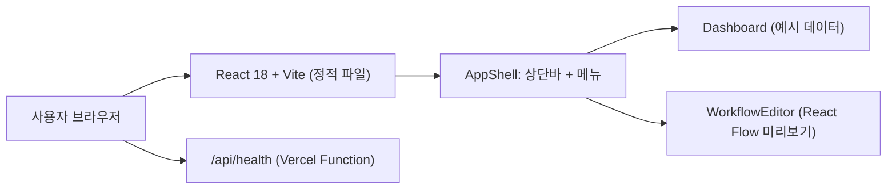

# ARCHITECTURE

목표 구조는 [FLOWBUILDER_DESIGN.md](FLOWBUILDER_DESIGN.md) 2장을 따릅니다.
이 문서는 **지금 실제로 구현된 것**만 적습니다. 구현이 바뀌면 이 문서도 같이 고칩니다.

## 현재 구현 (v0.1.0, 1단계)

## 구성요소

| 구성요소 | 파일 | 상태 |
| --- | --- | --- |
| 화면 틀 | `src/layout/AppShell.jsx` | 구현 |
| 메뉴 목록 | `src/menu.js` | 구현 |
| Dashboard | `src/pages/Dashboard.jsx` | 화면만 (예시 데이터) |
| Workflow Editor | `src/pages/WorkflowEditor.jsx` | 미리보기 (이동·연결만) |
| 상태 확인 API | `api/health.js` | 구현 |
| 인증 (Clerk) | - | 미구현 (2단계) |
| DB (MongoDB Atlas) | - | 미구현 (6단계) |
| 실행 엔진 / Runner Adapter | - | 미구현 (8~9단계) |

## 정한 것과 이유

| 결정 | 이유 |
| --- | --- |
| React 18로 고정 | 설계 문서의 확정 기술 스택 |
| 편집기 화면만 따로 불러오기(lazy) | React Flow가 무거워서 첫 화면을 가볍게 하려고 |
| 모바일은 메뉴를 Drawer로 전환 (기준: 화면 폭 900px) | 설계 문서 3.3 모바일 요구 |
| `vercel.json`에서 `/api/`를 뺀 모든 주소를 `index.html`로 연결 | 새로고침해도 화면이 뜨게 하려고 |
| Clerk 패키지는 아직 설치하지 않음 | 키 없이 넣으면 앱이 뜨지 않음. 2단계에서 추가 |

## 지켜야 할 경계

- 화면(React Flow)은 그리기만 합니다. 실행 로직을 화면에 넣지 않습니다.
- 브라우저에서 MongoDB에 직접 붙지 않습니다. 항상 `/api`를 거칩니다.
- 비밀 값은 서버 환경변수로만 둡니다. `VITE_`로 시작하는 값은 브라우저에 공개됩니다.
