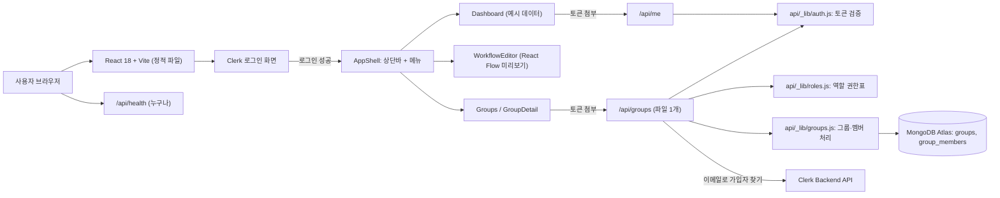

# ARCHITECTURE

목표 구조는 [FLOWBUILDER_DESIGN.md](FLOWBUILDER_DESIGN.md) 2장을 따릅니다.
이 문서는 **지금 실제로 구현된 것**만 적습니다. 구현이 바뀌면 이 문서도 같이 고칩니다.

## 현재 구현 (v0.3.0, 3단계)

## 구성요소

| 구성요소 | 파일 | 상태 |
| --- | --- | --- |
| 화면 틀 | `src/layout/AppShell.jsx` | 구현 |
| 메뉴 목록 | `src/menu.js` | 구현 |
| Dashboard | `src/pages/Dashboard.jsx` | 화면만 (예시 데이터) |
| Workflow Editor | `src/pages/WorkflowEditor.jsx` | 미리보기 (이동·연결만) |
| 상태 확인 API | `api/health.js` | 구현 |
| 로그인 화면 | `src/pages/SignInPage.jsx` | 구현 (실제 키 검증 전) |
| 로그인 여부에 따른 화면 전환 | `src/App.jsx`, `src/main.jsx` | 구현 |
| 서버 토큰 검증 | `api/_lib/auth.js` | 구현 |
| 로그인 확인 API | `api/me.js` | 구현 |
| API 호출 공통 함수 | `src/lib/api.js` | 구현 |
| 그룹 목록·만들기 화면 | `src/pages/Groups.jsx` | 구현 |
| 그룹 상세(멤버·역할) 화면 | `src/pages/GroupDetail.jsx` | 구현 |
| 그룹 API (주소 나누기) | `api/groups.js` | 구현 |
| 그룹·멤버 처리 | `api/_lib/groups.js` | 구현 |
| 역할 권한표 | `api/_lib/roles.js` (화면 표시용 이름은 `src/lib/roles.js`) | 구현 |
| Clerk 사용자 조회 | `api/_lib/clerkUsers.js` | 구현 |
| DB 연결 | `api/_lib/db.js` | 구현 (MongoDB Atlas) |
| 실행 엔진 / Runner Adapter | - | 미구현 (8~9단계) |

## 정한 것과 이유

| 결정 | 이유 |
| --- | --- |
| React 18로 고정 | 설계 문서의 확정 기술 스택 |
| 편집기 화면만 따로 불러오기(lazy) | React Flow가 무거워서 첫 화면을 가볍게 하려고 |
| 모바일은 메뉴를 Drawer로 전환 (기준: 화면 폭 900px) | 설계 문서 3.3 모바일 요구 |
| `vercel.json`에서 `/api/`를 뺀 모든 주소를 `index.html`로 연결 | 새로고침해도 화면이 뜨게 하려고 |
| Clerk 패키지는 `@clerk/react`, `@clerk/backend` | 예전 `@clerk/clerk-react`는 지원 종료 |
| 키가 없으면 로그인 없이 띄우고 경고 표시 | 키 없이 Clerk를 켜면 앱이 뜨지 않음 |
| 모든 API는 `requireUser()`를 첫 줄에서 호출 | 화면 제어만으로 보안을 대신하지 않기 위해 |
| `api/_lib` 폴더 이름을 `_`로 시작 | 공통 코드가 주소(API)로 노출되지 않게 |
| 그룹 API는 파일 1개 + `vercel.json` 다시쓰기 | Vercel 무료 등급은 배포당 함수 12개까지. 이후 단계도 기능 묶음마다 파일 1개로 |
| 그룹·멤버 처리를 HTTP와 분리(`api/_lib/groups.js`) | 토큰 없이 메모리 DB로 권한 규칙을 시험할 수 있게 |
| 멤버가 아니면 403이 아니라 404 | 남의 그룹이 있는지 알아낼 수 없게 |
| 서버가 `permissions`를 돌려주고 화면은 그대로 따름 | 권한표를 화면과 서버에 두 벌 두지 않기 위해 |
| 멤버 이메일·이름을 DB에 사본으로 저장 | 목록을 볼 때마다 Clerk를 부르지 않기 위해 |

## 지켜야 할 경계

- 화면(React Flow)은 그리기만 합니다. 실행 로직을 화면에 넣지 않습니다.
- 브라우저에서 MongoDB에 직접 붙지 않습니다. 항상 `/api`를 거칩니다.
- 비밀 값은 서버 환경변수로만 둡니다. `VITE_`로 시작하는 값은 브라우저에 공개됩니다.

## 로그인 흐름

1. 브라우저가 Clerk 화면에서 로그인합니다(이메일 또는 Google).
2. 화면이 API를 부를 때 Clerk가 준 토큰을 `Authorization: Bearer ...`로 붙입니다.
3. 서버는 `CLERK_SECRET_KEY`로 토큰이 진짜인지 확인하고 사용자 ID를 꺼냅니다.
4. 그룹 API는 이어서 `group_members`에서 내 역할을 찾고, 역할 권한표로 허용 여부를 정합니다.
