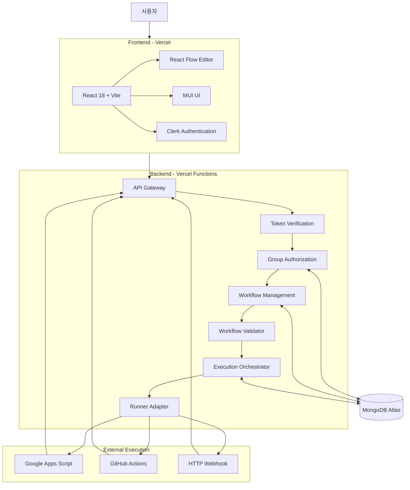
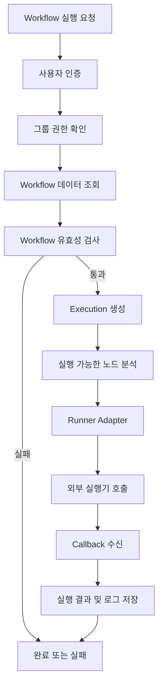

# FlowBuilder 통합 설계 문서

v1.8 · 2026-11-17

| 버전 | 바뀐 점 |
| --- | --- |
| v1.8 | 외부 연동(7.5): 인증정보 암호화, GAS·GitHub 실행기, Webhook, 자동 실행, 5분 주기 작업 |
| v1.7 | 실행 방식(7.4): 나눠서 진행, 노드별 동작, 입력값 쓰기, 한도 |
| v1.6 | 검증 규칙(7.3) |
| v1.5 | Workflow 저장 규칙(6.2): 버전 충돌 확인, 크기 한도, 삭제 권한 |
| v1.4 | 노드별 설정 항목 정의(4.3), Switch 갈래를 사용자가 정함 |
| v1.3 | 노드 저장 형태 확정(6.1: `type`은 분류, `data.kind`는 노드 종류), If/Else·Switch 출구 정의(4.1) |
| v1.2 | 역할 부여 규칙 추가(8.2), DB 연결을 3단계로 앞당김(12장) |
| v1.1 | Clerk 패키지 이름 반영(9장), DB 용량 정책 확정(14장) |
| v1.0 | 최초 작성 |

### 1. 프로젝트 개요

### 1.1 목적

FlowBuilder는 사용자가 시각적인 노드 편집기를 이용하여 업무 자동화 Workflow를 직접 설계하고 실행할 수 있는 웹 기반 자동화 플랫폼입니다.

Make 및 n8n과 유사한 노드 기반 자동화 방식을 제공하되, 외부 실행기를 연결하여 다양한 업무 자동화를 수행하는 것을 목표로 합니다.

### 1.2 핵심 요구사항

| 구분          | 요구사항                                        |
| ----------- | ------------------------------------------- |
| Workflow 편집 | 노드 생성, 이동, 삭제, 연결                           |
| 실행 흐름       | Trigger, Condition, Action                  |
| 분기 처리       | 조건에 따른 실행 경로 분리                             |
| 속성 관리       | 노드별 입력값 및 실행 설정                             |
| 그룹 관리       | 프로젝트 및 사용자 그룹                               |
| 인증          | 이메일 및 Google 로그인                            |
| 실행 관리       | 실행 상태, 결과, 오류 및 로그                          |
| 외부 연동       | Google Apps Script, GitHub Actions, Webhook |
| 반응형         | PC 및 모바일 편집 지원                              |
| 배포          | Vercel                                      |
| 소스 관리       | GitHub                                      |

### 2. 전체 시스템 아키텍처



### 2.1 구성요소별 역할

| 구성요소                   | 역할                         |
| ---------------------- | -------------------------- |
| React                  | 사용자 화면 구성                  |
| React Flow             | Workflow 시각적 편집            |
| MUI                    | UI 컴포넌트                    |
| Clerk                  | 로그인 및 인증                   |
| Vercel Functions       | 서버 API                     |
| MongoDB Atlas          | 사용자, 그룹, Workflow 및 실행 데이터 |
| Execution Orchestrator | 실행 순서 및 상태 관리              |
| Runner Adapter         | 외부 실행기 연결                  |
| GAS                    | Google 업무 자동화              |
| GitHub Actions         | 코드 및 작업 자동화                |
| Webhook                | 외부 시스템 호출                  |

### 3. 사용자 화면 레이아웃

### 3.1 메인 화면

```text
┌──────────────────────────────────────────────────────────────┐
│ FlowBuilder     Workspace ▼       Search       User Profile  │
├───────────────┬──────────────────────────────────────────────┤
│               │                                              │
│ Workspace     │  Dashboard                                   │
│               │                                              │
│ My Groups     │  ┌────────────┐ ┌────────────┐ ┌───────────┐ │
│               │  │ Workflows  │ │ Executions │ │ Failures  │ │
│ Projects      │  │     12     │ │    128     │ │     3     │ │
│               │  └────────────┘ └────────────┘ └───────────┘ │
│ Workflows     │                                              │
│ Executions    │  Recent Workflows                            │
│ Credentials   │                                              │
│ Settings      │  Workflow Name    Status       Updated       │
│               │  Email Automation Active      2026-11-16    │
│               │  Data Collection  Draft        2026-11-15    │
│               │                                              │
└───────────────┴──────────────────────────────────────────────┘
```

### 3.2 Workflow Editor


```text
┌──────────────────────────────────────────────────────────────┐
│ FlowBuilder / Project / Workflow Name                        │
├──────────────────────────────────────────────────────────────┤
│ Save     Undo     Redo       Validate       Run       Publish │
├──────────────┬───────────────────────────────┬───────────────┤
│              │                               │               │
│ Node Palette │       Workflow Canvas         │ Properties    │
│              │                               │               │
│ Trigger      │       ┌──────────────┐        │ Node Name     │
│              │       │   Trigger    │        │               │
│ Schedule     │       └──────┬───────┘        │ Parameters    │
│ Webhook      │              │                │               │
│ Manual       │       ┌──────▼───────┐        │ Input         │
│              │       │  Condition   │        │               │
│ Condition    │       └───┬──────┬───┘        │ Output        │
│              │           │      │             │               │
│ If / Else    │        YES       NO            │ Test Node     │
│ Switch       │         │        │             │               │
│              │      Action   Action           │               │
│ Action       │                               │               │
│              │                               │               │
│ HTTP Request │                               │               │
│ GAS          │                               │               │
│ GitHub       │                               │               │
├──────────────┴───────────────────────────────┴───────────────┤
│ Execution History / Logs / Errors / Results                  │
└──────────────────────────────────────────────────────────────┘
```

### 3.3 화면 영역별 기능

| 영역                 | 기능                    |
| ------------------ | --------------------- |
| 상단 Toolbar         | 저장, 실행, 검증, 게시, 실행 취소 |
| 좌측 Node Palette    | 노드 검색 및 추가            |
| 중앙 Canvas          | 노드 배치 및 연결            |
| 우측 Properties      | 선택한 노드의 속성 설정         |
| 하단 Execution Panel | 실행 결과, 로그, 오류 확인      |

모바일에서는 좌측 노드 목록과 우측 속성 패널을 별도 Drawer 또는 하단 패널로 전환합니다. 캔버스의 노드 선택, 이동, 연결 및 확대·축소 기능도 제공해야 합니다.

### 4. Workflow 편집기 설계

### 4.1 노드 유형

| 유형        | 노드                 | 설명                 |
| --------- | ------------------ | ------------------ |
| Trigger   | Manual             | 수동 실행              |
| Trigger   | Schedule           | 예약 실행              |
| Trigger   | Webhook            | 외부 요청으로 실행         |
| Condition | If / Else          | 조건 분기              |
| Condition | Switch             | 다중 조건 분기           |
| Action    | HTTP Request       | REST API 호출        |
| Action    | Google Apps Script | GAS 실행             |
| Action    | GitHub Actions     | GitHub Workflow 실행 |
| Action    | Data Transform     | 데이터 변환             |
| Action    | Delay              | 지정 시간 대기           |

노드 출구 (v1.3 추가, 4단계 구현)

* Trigger는 들어오는 연결점이 없습니다.
* If / Else는 출구가 YES·NO 두 개입니다. 연결선에 출구 이름이 표시됩니다.
* Switch는 사용자가 정한 갈래(1~10개) + 기본입니다 (v1.4). 갈래를 지우면 그 갈래의 선도 지워집니다.
* 나머지 노드는 출구가 하나입니다.

노드 저장 형태 (v1.3 확정)

* `type`: 분류 (`trigger` / `condition` / `action`) — 6.1 예시와 같음
* `data.kind`: 노드 종류 (`manual`, `schedule`, `webhook`, `ifElse`, `switch`, `http`, `gas`, `githubActions`, `transform`, `delay`)
* `data.label`: 화면에 보이는 노드 이름
* `data.params`: 노드별 설정 값 (v1.4, 아래 4.3)
* 연결선의 `sourceHandle`: 어느 출구에서 나왔는지 (`yes`, `no`, `case_1` …, 출구가 하나면 null)

### 4.3 노드별 설정 항목 (v1.4 추가, 5단계 구현)

설계 v1.0에는 노드별 입력 항목이 없어 5단계에서 정했습니다. 코드: `src/editor/nodeFields.js`. 앞 노드의 값은 `{{input.이름}}`으로 씁니다. 인증정보(토큰·키)는 여기에 넣지 않고 Credentials 메뉴(7.5)에서 등록해 노드에서 고릅니다.

| 노드 | 항목 (* 필수) |
| --- | --- |
| Manual | 없음 |
| Schedule | 반복(매시간·매일·매주), 분*(매시간), 요일(매주), 시각*. 한국 시간 기준 |
| Webhook | 받을 요청 방식(GET·POST). 주소는 서버 저장(6단계) 후 생성 |
| If / Else | 비교할 값*, 조건(같다·다르다·포함·크다·작다·비어 있다·비어 있지 않다), 기준 값 |
| Switch | 나눌 값*, 갈래 목록(이름*, 일치 값) 1~10개 |
| HTTP Request | 요청 방식, 주소*(http/https), 헤더(JSON), 보낼 내용(GET 제외), 제한 시간*(1~300초) |
| Google Apps Script | 웹 앱 주소*(script.google.com), 함수 이름, 보낼 값(JSON) |
| GitHub Actions | 저장소*(owner/repo), Workflow 파일*, 브랜치*, 입력값(JSON) |
| Data Transform | 결과 모양*(JSON) |
| Delay | 시간*(1 이상), 단위(초·분·시간). 최대 24시간 |

속성 패널은 입력칸마다 바로 검사해 문구를 보여 주고, 문제가 있는 노드에는 "설정 필요 N곳"을 표시합니다. 흐름 전체 검사(연결 누락 등)는 7단계 Validator가 합니다.

### 4.2 사용자 제어 범위

사용자는 React Flow를 통해 다음 작업을 직접 수행할 수 있어야 합니다.

* 노드 추가 및 삭제

* 노드 위치 이동

* 노드 간 연결 및 연결 해제

* 연결선 재설정

* 노드 속성 변경

* 조건 및 분기 설정

* 캔버스 확대·축소

* 실행 흐름 검증

* Workflow 저장 및 불러오기

설계 원칙: React Flow는 편집기 역할을 담당하며 실제 실행 엔진은 별도로 구현합니다. 사용자가 노드를 배치했다고 해서 자동으로 실행되는 구조가 되어서는 안 됩니다.

### 5. 주요 기능 및 메뉴 구조

```text
FlowBuilder
│
├── Dashboard
│
├── Workspace
│   ├── Group Management
│   ├── Member Management
│   └── Permission Management
│
├── Workflow
│   ├── Workflow List
│   ├── Workflow Editor
│   ├── Workflow Version
│   └── Workflow Publish
│
├── Execution
│   ├── Execution History
│   ├── Execution Detail
│   ├── Execution Logs
│   └── Error / Retry
│
├── Integration
│   ├── Google Apps Script
│   ├── GitHub Actions
│   └── Webhook
│
├── Credentials
│   ├── Credential List
│   └── Credential Management
│
└── Settings
    ├── User Settings
    ├── Workspace Settings
    └── System Settings
```

### 6. 데이터베이스 설계

MongoDB Atlas를 사용하며 다음 컬렉션으로 구성합니다.

| 컬렉션               | 주요 데이터                    |
| ----------------- | ------------------------- |
| users             | 사용자 정보, Clerk ID          |
| groups            | 그룹 정보                     |
| group_members     | 사용자별 그룹 권한                |
| workflows         | Workflow 정의, nodes, edges |
| workflow_triggers | 실행 Trigger 설정             |
| executions        | 실행 이력 및 상태                |
| execution_logs    | 노드별 실행 로그                 |
| credentials       | 외부 연동 인증정보                |

### 6.1 Workflow 데이터 예시

```json
{
  "_id": "workflow_id",
  "groupId": "group_id",
  "name": "Email Automation",
  "description": "이메일 자동화 Workflow",
  "version": 1,
  "status": "draft",
  "nodes": [
    {
      "id": "trigger_1",
      "type": "trigger",
      "position": {
        "x": 100,
        "y": 100
      },
      "data": {
        "label": "Manual Trigger"
      }
    },
    {
      "id": "action_1",
      "type": "action",
      "position": {
        "x": 400,
        "y": 100
      },
      "data": {
        "label": "HTTP Request"
      }
    }
  ],
  "edges": [
    {
      "id": "edge_1",
      "source": "trigger_1",
      "target": "action_1"
    }
  ]
}
```

실제 운영 환경에서는 노드의 실행 설정, 입력·출력 스키마, 연결 Handle, 생성 및 수정 이력 등을 추가합니다.

### 6.2 Workflow 저장 규칙 (v1.5 추가, 6단계 구현)

* Workflow는 그룹 하나에 속합니다. 권한은 그 그룹의 역할을 따릅니다 (8.2: 조회는 모든 멤버, 만들기·저장·삭제는 Owner·Admin·Editor).
* 저장할 때 불러온 버전(version)을 같이 보냅니다. 그 사이 다른 사람이 저장했으면 덮어쓰지 않고 알립니다(VERSION_CONFLICT). 사용자는 최신 내용을 다시 불러와 고칩니다.
* 서버는 nodes·edges 모양을 검사하고 설계 6.1 필드만 저장합니다. 흐름이 실행 가능한지는 7단계 Validator가 봅니다.
* 무료 DB(512MB)를 지키기 위한 한도: 노드 200개, 연결선 400개, nodes+edges 200KB, 그룹당 Workflow 100개.
* 그룹을 지우면 그 그룹의 Workflow도 지웁니다.
* 저장 전의 "새 Workflow"는 브라우저에 임시 저장하고, 처음 저장할 때 그룹과 이름을 고릅니다.

### 7. Workflow 실행 구조

### 7.1 실행 프로세스



### 7.2 실행 상태

| 상태        | 설명    |
| --------- | ----- |
| pending   | 실행 대기 |
| running   | 실행 중  |
| success   | 성공    |
| failed    | 실패    |
| cancelled | 취소    |
| retrying  | 재시도 중 |

실행 엔진은 조건 분기, 노드별 데이터 전달, 실행 순서, 오류 처리, 재시도 및 실행 로그를 관리해야 합니다.

### 7.3 Workflow 검증 규칙 (v1.6 추가, 7단계 구현)

검증 코드는 하나(`shared/validator.js`)이고 화면과 서버가 같이 씁니다. 화면의 Validate 버튼은 지금 화면의 흐름을, 서버(`POST /api/workflows/:id/validate`)는 저장된 흐름을 검사합니다. 8단계 실행은 서버 검증에서 오류가 있으면 실행하지 않습니다(7.1의 "Workflow 유효성 검사").

오류는 실행을 막고, 경고는 실행은 되지만 의도와 다를 수 있음을 알립니다. 저장은 오류가 있어도 됩니다(그리던 중인 흐름).

| 규칙 | 수준 | 내용 |
| --- | --- | --- |
| EMPTY | 오류 | 노드가 하나도 없음 |
| NO_TRIGGER | 오류 | Trigger 노드가 없음 |
| MULTIPLE_TRIGGERS | 경고 | Trigger가 여러 개 (각자 자기 뒤의 흐름만 실행) |
| UNKNOWN_NODE | 오류 | 모르는 노드 종류, 또는 분류(type)가 종류와 안 맞음 |
| NAME_REQUIRED | 오류 | 노드 이름이 비어 있음 |
| INVALID_PARAM | 오류 | 보이는 설정 칸의 필수값·형식 오류 (설계 4.3. 숨겨진 칸은 검사 안 함) |
| BROKEN_EDGE | 오류 | 없는 노드에 이어진 선 |
| SELF_LOOP | 오류 | 자기 자신에게 이어진 선 |
| INTO_TRIGGER | 오류 | Trigger로 들어오는 선 |
| INVALID_OUTPUT | 오류 | 없는 출구에서 나가는 선 (예: 지운 Switch 갈래) |
| CYCLE | 오류 | 순환 연결. 지금 실행 엔진은 되돌아가는 흐름(반복)을 지원하지 않음 |
| DUPLICATE_EDGE | 경고 | 같은 출구 → 같은 노드 선이 두 번 |
| UNREACHABLE | 경고 | Trigger에서 닿지 않아 실행되지 않는 노드 |
| TRIGGER_ALONE | 경고 | 뒤에 이어진 노드가 없는 Trigger |
| OPEN_BRANCH | 경고 | 조건 노드의 비어 있는 갈래 (그 경우 흐름이 끝남) |

### 7.4 실행 방식 (v1.7 추가, 8단계 구현)

**나눠서 진행**: Vercel 함수는 오래 돌 수 없으므로 실행을 한 번에 끝내지 않습니다. 요청 한 번에 정해진 시간(시작 20초, 상태 조회 8초)만 노드를 처리하고 상태를 DB에 저장한 뒤, 다음 요청에서 이어서 합니다. 같은 실행을 두 요청이 동시에 처리하지 않도록 잠급니다.

**지금 이어서 진행시키는 것**: 화면이 실행 결과 창을 열어 두고 상태를 물어볼 때(1.5초, 기다리는 중이면 5초마다). 9단계부터는 5분마다 서버 주기 작업(`/api/cron`)도 기다리는 실행을 이어서 진행합니다(7.5).

**실행 순서**: 시작 Trigger에서 선을 따라 한 노드씩 처리합니다. 조건 노드는 고른 갈래로만 갑니다. 여러 선이 한 노드로 모이면 먼저 도착한 쪽의 값으로 한 번만 실행합니다. 실패하면 그 자리에서 멈추고 실행하지 않은 노드는 "건너뜀"이 됩니다. 재시도(retrying)는 아직 없습니다.

**실행 전 확인**: 저장된 버전만 실행합니다(저장 안 된 화면 내용은 실행하지 않음). 실행 전에 7.3 검증을 하고 오류가 있으면 실행하지 않습니다. 실행 중에 Workflow를 고쳐도 영향이 없도록 시작할 때의 모습을 복사해 쓰고, 끝나면 복사본을 지웁니다.

**입력값 쓰기**: Run 창에서 넣은 JSON이 Trigger의 출력이 됩니다. 각 노드는 앞 노드의 출력을 `{{input.이름}}`으로 씁니다(`{{input.items[0].id}}`처럼 안쪽도 가능). 칸 전체가 `{{...}}` 하나면 원래 형태(숫자·객체)를 그대로 씁니다.

| 노드 | 실행할 때 하는 일 | 출력 |
| --- | --- | --- |
| Manual·Schedule·Webhook | 받은 입력을 그대로 넘김 | 입력 그대로 |
| If / Else | 조건 계산 → YES 또는 NO | 입력 그대로 |
| Switch | 나눌 값과 같은 "일치 값"의 갈래, 없으면 기본 | 입력 그대로 |
| Data Transform | 결과 모양 JSON의 `{{...}}`를 채움 | 채운 JSON |
| Delay | 정한 시간까지 기다림(실행 상태 "기다리는 중") | 입력 그대로 |
| HTTP Request | 서버에서 바로 요청 (최대 15초) | `{ status, body }` |
| GAS·GitHub Actions | 7.5의 실행기로 실행 | GAS: 응답의 `result` / GitHub: `{ runId, htmlUrl, status, conclusion }` |

**HTTP 보안**: 서버 내부·사설망·클라우드 메타데이터 주소(localhost, 10.x, 172.16~31.x, 192.168.x, 169.254.x 등)로는 보내지 않습니다. 주소 이름이 그런 IP로 풀려도 막고, 다른 주소로 넘기는 응답(redirect)은 따라가지 않습니다. 2xx가 아니면 실패로 봅니다.

**한도 (무료 DB 512MB)**: 노드 결과는 앞 2KB까지만 저장, 입력값 10KB, Workflow당 동시 진행 3개, Workflow당 최근 50개 기록만 남김. Workflow나 그룹을 지우면 실행 기록도 지웁니다. 30일 자동 삭제는 10단계.

**권한**: 실행·취소는 Owner·Admin·Editor(8.2의 "실행"), 기록 보기는 모든 멤버.

### 7.5 외부 연동과 자동 실행 (v1.8 추가, 9단계 구현)

**인증정보(Credentials)**: GitHub 토큰·GAS 비밀값·HTTP 인증 헤더는 노드 설정에 직접 넣지 않고 Credentials 메뉴에 그룹별로 등록합니다. 비밀값은 AES-256-GCM으로 암호화해 저장하고(키는 서버 환경변수 `CREDENTIALS_KEY`), 화면에는 끝 4글자만 보입니다. 등록·삭제는 Owner·Admin, 목록 보기는 멤버입니다. 노드는 인증정보 ID만 가지며, 실행 엔진이 그 Workflow 그룹의 것만 꺼내 씁니다. 지우면 그 인증정보를 쓰는 노드는 다음 실행에서 실패합니다.

**GAS 실행기**: Apps Script를 웹 앱으로 배포한 주소에 `{ function, payload, token }`을 POST로 보내고 응답 JSON의 `result`를 출력으로 씁니다. 응답은 15초까지 기다립니다. 웹 앱이 넘기는 `script.googleusercontent.com`만 따라가고 다른 곳으로 넘기면 실패합니다. 주소는 `script.google.com`이어야 하고 HTTP 노드와 같은 내부 주소 차단을 거칩니다. Apps Script 쪽 견본은 `docs/GAS_TEMPLATE.md`.

**GitHub Actions 실행기**: `workflow_dispatch`로 시작하고 실행 번호를 받으면 "기다리는 중"으로 두고 15초마다 상태를 확인합니다(최대 6시간). 성공이면 출력은 `{ runId, htmlUrl, status, conclusion }`, 다른 결론이면 실패. 실행 번호를 받지 못하면 시작만 확인하고 성공으로 보며 그 사실을 출력에 적습니다. Callback은 쓰지 않습니다(함수가 짧고 받는 주소를 열지 않으려고).

**자동 실행**: 저장된 Workflow의 "자동 실행"을 켜면(`status: active`) Webhook과 Schedule이 동작합니다. 켤 때 7.3 검증을 하고, 켠 뒤 오류가 있는 모양으로 저장하면 자동으로 꺼집니다. 꺼져 있으면 Webhook은 409, Schedule은 실행하지 않습니다.

**Webhook**: 노드마다 `/api/hooks/<무작위 토큰>` 주소를 만들 수 있고(새로 만들면 이전 주소는 멈춤), 로그인 없이 부르므로 토큰이 곧 열쇠입니다. 정한 요청 방식(GET/POST)만 받고, 내용은 10,000자까지입니다. 받은 `{ body, query }`가 Trigger의 출력이 되고 요청에는 바로 202로 답합니다.

**예약 실행(Schedule)**: 시각은 한국 시간. 매시간(분)·매일·매주(요일, 시각). 5분마다 도는 주기 작업이 "가장 가까운 지난 예약 시각"을 계산해, 아직 맡지 않은 시각이면 먼저 맡았다고 기록한 뒤 실행합니다(같은 시각 한 번만). 켜기 전의 시각은 실행하지 않고, 1시간 넘게 늦은 시각은 건너뜁니다. 몇 분 늦을 수 있습니다.

**주기 작업**: Vercel 무료(Hobby) 크론은 하루 한 번이라, GitHub Actions(`flowbuilder-tick.yml`)가 5분마다 `POST /api/cron`을 `CRON_SECRET`으로 부릅니다. 예약 확인 뒤 기다리는 실행을 최대 15초 진행합니다. GitHub은 저장소에 60일 동안 변경이 없으면 예약 실행을 멈추므로 멈추면 다시 켜야 합니다.

### 8. 인증 및 권한 설계

### 8.1 인증

* 인증 서비스: Clerk

* 이메일 로그인

* Google 로그인

* 서버 API에서 Clerk 토큰 검증

### 8.2 권한

| 역할     | 조회  | 편집  | 실행  | 멤버 관리 |
| ------ | --- | --- | --- | ----- |
| Owner  | O   | O   | O   | O     |
| Admin  | O   | O   | O   | O     |
| Editor | O   | O   | O   | X     |
| Viewer | O   | X   | X   | X     |

그룹 권한은 서버에서 검증해야 하며 프론트엔드 화면 제어만으로 보안을 구현해서는 안 됩니다.

역할 부여 규칙 (v1.2 추가, 3단계 구현)

* 그룹을 만든 사람이 Owner가 됩니다.
* Owner는 모든 역할을 주고 바꾸고 내보낼 수 있습니다. 그룹 삭제는 Owner만 합니다.
* Admin은 Editor·Viewer만 추가·변경·내보내기 합니다. Owner·Admin을 만들거나 건드리지 못합니다.
* 누구나 스스로 그룹을 나갈 수 있습니다.
* 그룹에는 Owner가 한 명 이상 남아야 합니다.
* 멤버 추가는 이미 가입한 사람의 이메일로 합니다. (초대 메일은 아직 없음)
* 멤버가 아닌 사람에게는 그룹이 있다는 사실도 알리지 않습니다(404).

### 9. 기술 스택

| 구분              | 기술                             |
| --------------- | ------------------------------ |
| Frontend        | React 18                       |
| Build           | Vite                           |
| Language        | JavaScript                     |
| Workflow Editor | @xyflow/react                  |
| UI Framework    | MUI                            |
| Authentication  | Clerk (@clerk/react, @clerk/backend) |
| Backend         | Vercel Functions               |
| Database        | MongoDB Atlas Free             |
| Hosting         | Vercel                         |
| Source Control  | GitHub                         |
| External Runner | GAS / GitHub Actions / Webhook |

### 10. 보안 및 운영 원칙

* 브라우저에서 MongoDB에 직접 접속하지 않습니다.

* Clerk Secret Key와 MongoDB URI는 서버 환경변수로 관리합니다.

* 외부 서비스 인증정보는 평문으로 저장하지 않습니다.

* 모든 API에서 사용자 인증과 그룹 권한을 검증합니다.

* 외부 실행 요청은 서명 또는 비밀 토큰으로 검증합니다.

* Callback 요청의 중복 수신을 고려하여 멱등성을 보장합니다.

* 장시간 실행 작업은 Vercel Function에서 직접 수행하지 않고 외부 실행기로 위임합니다.

* 실행 이력과 노드별 로그를 별도 관리합니다.

### 11. 변경관리 및 인수인계 지침

필수 준수 사항

프로그램을 수정하는 모든 개발자와 AI는 변경관리 문서를 반드시 업데이트해야 합니다.

### 11.1 변경관리 대상

* 소스 코드

* DB 스키마

* API 명세

* Workflow 노드 구조

* 인증 및 권한

* 외부 서비스 연동

* 환경변수 및 배포 설정

* 시스템 아키텍처

### 11.2 변경 기록 항목

| 항목    | 기록 내용       |
| ----- | ----------- |
| 변경일   | 실제 변경 일자    |
| 작업자   | 개발자 또는 AI   |
| 변경 목적 | 수정 이유       |
| 변경 파일 | 수정된 파일 목록   |
| 영향 범위 | 연관 기능 및 시스템 |
| 검증 결과 | 실제 수행한 테스트  |
| 배포 상태 | 배포 여부       |
| 롤백 방법 | 원복 절차       |

### 11.3 반드시 지켜야 할 규칙

* 설계와 구현이 달라지면 설계 문서를 업데이트합니다.

* API 또는 DB가 변경되면 해당 명세도 수정합니다.

* README에 주요 변경 사항을 반영합니다.

* 테스트하지 않은 항목을 통과했다고 기록하지 않습니다.

* 긴급 수정도 변경 기록을 남깁니다.

* 변경관리 문서가 업데이트되지 않은 작업은 완료 처리하지 않습니다.

### 12. 개발 진행 순서

| 순서  | 개발 단계        | 주요 결과물                 |
| --- | ------------ | ---------------------- |
| 1   | 프로젝트 초기 구성   | React + Vite           |
| 2   | 인증 구현        | Clerk 로그인              |
| 3   | 그룹 관리        | 그룹 및 권한, MongoDB 연결 (v1.2: 6단계에서 앞당김) |
| 4   | Workflow 편집기 | React Flow             |
| 5   | 노드 속성 관리     | Properties Panel       |
| 6   | Workflow 저장  | MongoDB 연동             |
| 7   | Workflow 검증  | Validator              |
| 8   | 실행 엔진        | Execution Orchestrator |
| 9   | 외부 연동        | GAS / GitHub / Webhook |
| 10  | 실행 이력        | Logs / History         |
| 11  | 모바일 최적화      | Responsive Editor      |
| 12  | 배포 및 검증      | Vercel                 |

### 13. 후임 개발자 및 AI 전달 지침

아래 내용을 프로젝트의 `AI_HANDOFF_PROMPT.md`로 사용하면 됩니다.

```markdown
# FlowBuilder Development Instructions

당신은 FlowBuilder 프로젝트의 설계와 구현을 담당하는
시니어 풀스택 개발자입니다.

## 프로젝트 목표
React Flow 기반의 Workflow Automation 플랫폼을 구현합니다.

## 확정 기술 스택
- React 18
- Vite
- JavaScript
- @xyflow/react
- MUI
- Clerk
- Vercel Functions
- MongoDB Atlas
- GitHub

## 필수 구현 원칙
1. Workflow 편집과 실행 엔진을 분리합니다.
2. 모든 API는 인증 및 그룹 권한을 검증합니다.
3. Workflow는 nodes와 edges 구조로 저장합니다.
4. 실행 이력과 로그는 별도 관리합니다.
5. 외부 실행기는 Adapter 구조로 구현합니다.
6. 모바일에서도 Workflow 편집을 지원합니다.
7. 보안정보를 클라이언트에 노출하지 않습니다.

## 변경관리 의무
프로그램을 수정하면 반드시 다음 문서를 업데이트합니다.

- README.md
- ARCHITECTURE.md
- CHANGE_MANAGEMENT.md
- API_SPECIFICATION.md
- DATABASE_DESIGN.md

설계와 구현이 달라지면 설계 문서도 함께 수정합니다.

변경관리 문서가 누락된 작업은 완료로 처리하지 않습니다.

## 작업 보고
각 작업마다 다음을 보고합니다.

- 작업 목적
- 변경 파일
- 변경 내용
- 테스트 결과
- 미완료 항목
- 다음 작업

실제로 수행하지 않은 테스트를 완료했다고 보고하지 않습니다.
```

### 14. 현재 문서의 범위 및 미확정 사항

이 문서는 현재까지 합의한 요구사항을 기반으로 작성한 통합 설계 레이아웃입니다. 실제 소스 코드, API 세부 명세, DB 인덱스, 노드별 입출력 스키마 및 실행 엔진 상세 구현은 아직 포함하지 않았습니다.

다음 항목은 구현 전에 추가 확정이 필요합니다.

* Workflow 버전 및 게시 정책

* 예약 Trigger 실행을 담당할 스케줄러

* 실행 결과 Callback 인증 방식

* 실패한 노드의 재시도 및 복구 정책

* ~~Credential 암호화 및 키 관리 방식~~ → 확정 (2026-11-17): AES-256-GCM, 키는 환경변수 `CREDENTIALS_KEY`. 키 회전은 미정

* ~~예약 Trigger 실행 스케줄러~~ → 확정 (2026-11-17): GitHub Actions 5분 주기 (7.5)

* ~~실행 결과 Callback 인증 방식~~ → 확정 (2026-11-17): Callback을 쓰지 않음 (7.5)

* ~~MongoDB Free 플랜의 용량 및 운영 한도~~ → 확정 (2026-11-16): 512MB 한도, 실행 로그 30일 자동 삭제, 노드 결과 2KB 제한. 상세는 `DATABASE_DESIGN.md`
